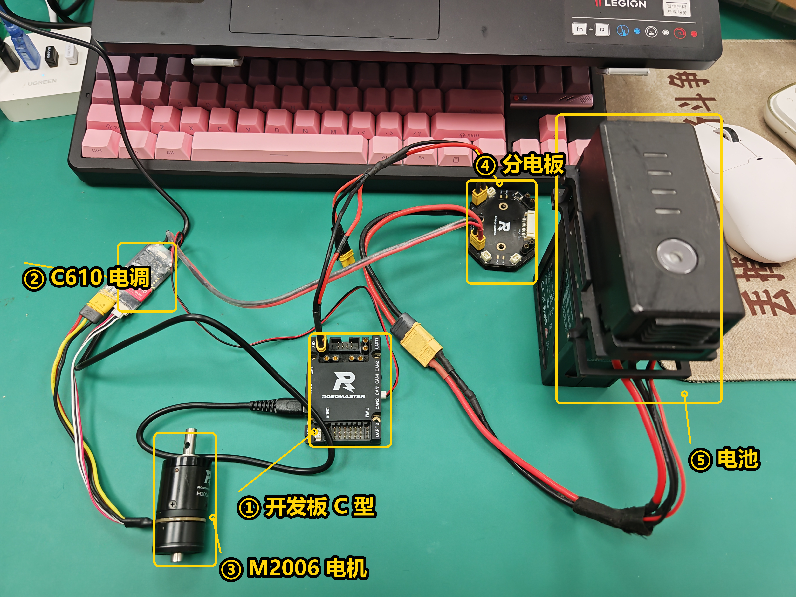
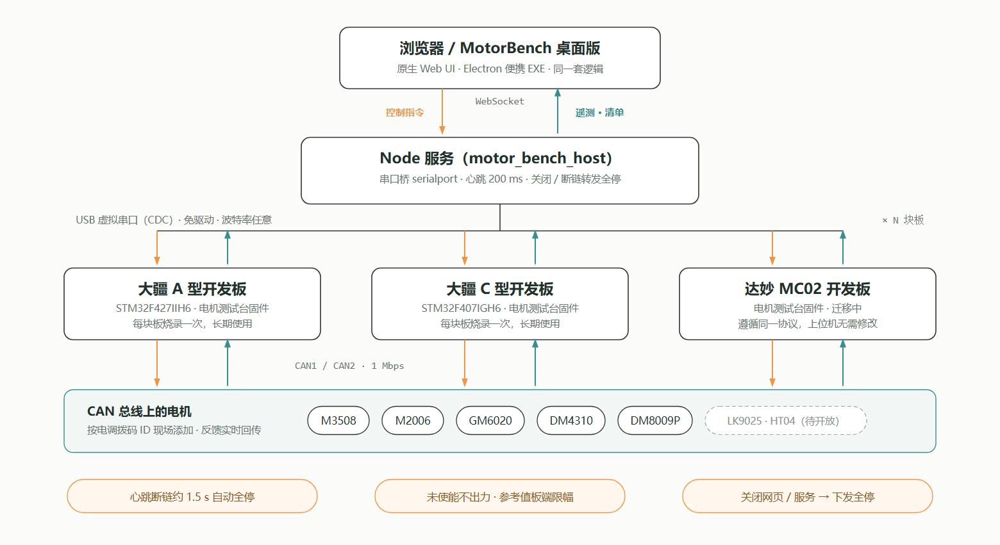
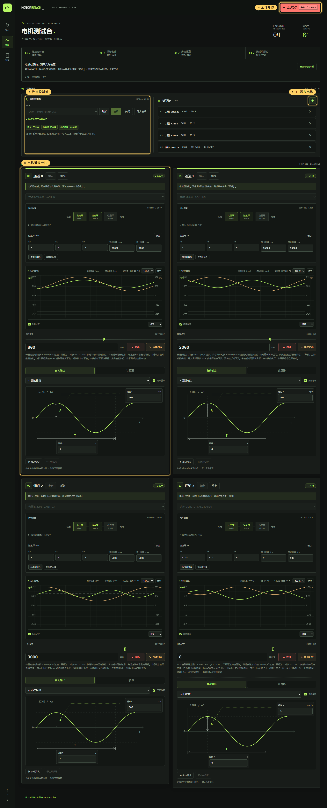
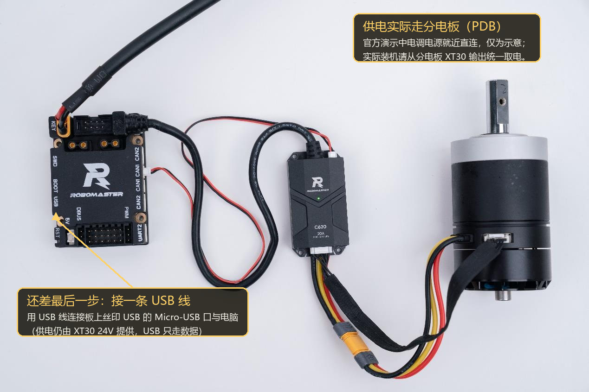
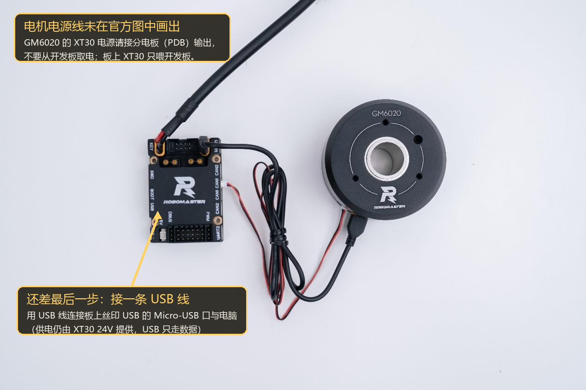

# RM-MotorBench · RoboMaster 实验室电机测试台

> 多用途复合电机测试台 —— 换电机不烧固件、不改配置，网页上点几下就能测。



网页设定电机种类与转速，指令经 **USB 虚拟串口**下发到永久烧录固件的开发板（支持**大疆 A 型、C 型及达妙 MC02**；MC02 已完成源码迁移和编译，待实机验证），
由开发板驱动 CAN 总线上的常见无刷电机，转速、电流、温度**实时回传**。
实验室里机械组想测一颗电机，不用再找电控组改代码、烧板子 —— 配置全在网页上，测试变成点几下的事；
也适合发射机构简单测试（射频换算 + 拨弹盘实测）和自旋靶车（正弦/阶梯速度输出）这类场景。

## 核心特性

- **免烧固件换电机**：按电调拨码 ID 在网页现场添加/删除，板端动态建电机
- **多开发板支持**：多板各自独立固件工程，上位机同一套
- **速度 / 位置 / 电流三环**：闭环在线切换，PID 网页整定并写入电机
- **测试工具内建**：实时曲线、正弦/阶梯自动转速输出、射频→转速计算器、单发/双发拨弹位置测试
- **安全设计**：心跳断链约 1.5s 自动全停；未使能不出力；关页面/关服务下发全停；空格急停
- **支持型号**：大疆 M3508 / M2006 / GM6020，达妙 DM4310 / DM8009P
  （岭芯 LK9025、海泰 HT04 底层已接入，待实机验证后开放下拉选项）

## 两种使用方式

功能完全相同、可同时运行，按需选择：

| | 桌面便携版（推荐给机械组） | 浏览器版 |
|---|---|---|
| 形态 | 单个 `MotorBench-1.1.1-Windows-x64.exe` | `npm start` + 浏览器 |
| 前置依赖 | 无（内置 Electron / 网页 / 串口依赖，可离线） | Node.js 22.12+ |
| 打开方式 | 双击，进入独立调试窗口 | 手动打开 `http://127.0.0.1:3000` |
| 端口 | 自动选空闲端口，**不占 3000** | 固定 3000（可 `--port` 改） |
| 适用 | 日常测电机、分发给机械组 | 改代码、调试上位机本身 |

下载见 [GitHub Releases](https://github.com/wbz2006/RM-MotorBench/releases)。

## 系统架构



| 环节 | 实现 |
|---|---|
| 前端 | 原生 Web UI（无框架依赖） |
| 桥接 | Node + WebSocket + serialport |
| 传输 | USB CDC 虚拟串口（MC02 使用 HS 外设的全速模式） |
| 控制 | A 板 STM32F427IIH6 / C 板 STM32F407IGH6 / MC02 STM32H723VGT6 |
| 驱动 | CAN 总线，支持常见的无刷电机 |

## 目录与文档

| 目录 | 说明 |
|---|---|
| [`motorbench-a`](motorbench-a) | **固件主工程**（A 板）。CubeMX + CMake/Ninja，后续开发来源，[固件说明](motorbench-a/README.md) |
| [`motorbench-c`](motorbench-c) | **C 板固件**。从 A 板迁入的独立快照，不自动同步，[迁移与验证说明](motorbench-c/README.md) |
| [`motorbench-mc02`](motorbench-mc02) | **MC02 固件**。H723 / FDCAN / USB CDC 独立工程，[迁移与验证说明](motorbench-mc02/README.md) |
| [`motor_bench_host`](motor_bench_host) | **上位机**。含 Electron 打包配置与详细使用教程，[上位机说明](motor_bench_host/README.md) |
| [`docs`](docs) | 三板功能对照与文档配图，[固件对照](docs/FIRMWARE_PARITY.md) |
| [`tools`](tools) | Windows 启动器与文档配图维护脚本，[使用说明](tools/README.md) |
| `启动电机测试台.bat` | 双击启动浏览器版上位机 |

## 快速开始

### ① 编译并烧录固件

在 VS Code 中打开 `motorbench-a`（A 板）、`motorbench-c`（C 板）或 `motorbench-mc02`（MC02），装好
**STM32CubeIDE for Visual Studio Code** 扩展（首次使用在其工具管理里装 CMake / Ninja /
ARM GCC / ST-Link·J-Link），接好供电与 SWD，在「运行和调试」选对应配置按 F5 ——
编译、下载、运行一步完成。**各板固件不可混用。**

命令行（可选，CI / 脚本场景）：

```powershell
cd motorbench-a        # 或 motorbench-c / motorbench-mc02
cmake --preset Debug
cmake --build --preset Debug --parallel
```

详细步骤与调试配置见 [A 板固件说明](motorbench-a/README.md) / [C 板固件说明](motorbench-c/README.md) / [MC02 固件说明](motorbench-mc02/README.md)。三套工程当前功能与验证范围见 [固件功能对照](docs/FIRMWARE_PARITY.md)。

### ② 启动上位机

**桌面版**：下载 Release 里的 `MotorBench-x.x.x-Windows-x64.exe` 双击即可，无需装 Node.js；
关闭窗口自动全停并退出，重复双击只激活已有窗口。

**浏览器版**：

```powershell
cd motor_bench_host
npm install
npm start             # 打开 http://127.0.0.1:3000
```

改 `server.js` / `protocol.js` 后需重启 Node 服务；只改 HTML/CSS/网页脚本刷新即可。

### ③ 添加电机并测试



1. XT30 接 **24V** 电源，USB 线接开发板 Micro-USB
2. 网页选串口 → 打开（Windows 设备管理器里产品名 `Motor Bench CDC`，普通 USB 线即可）
3. 右上角 `＋` 添加电机：型号 / 总线 / 电调 ID（按电调拨码实际值填）
4. 通道卡片里选电机 → 绑定 → 使能 → 拖动滑块设转速
5. 列表行末 `×` 移除电机；结束时「停机」或按空格急停

更多操作细节（拨弹测试、PID 整定、自动输出、计算器、页面引导）见
[上位机说明](motor_bench_host/README.md)。

## ⚠️ CAN ID 规则（重要）

同一 CAN 总线的反馈 ID 不能重复：

| 电机 | 反馈 ID |
|---|---|
| GM6020 | `0x204 + ID` |
| M3508 / M2006 | `0x200 + ID` |

两段区间在 `0x205~0x208` **重叠**：GM6020 的 ID 1~4 与 M3508/M2006 的 ID 5~8 互相冲突。
添加前页面会列出冲突对象和当前型号可用的 ID；也可以把冲突电机接到不同 CAN 总线。

**达妙 DM-4310 / DM8009P** 走 MIT 协议，TX（控制指令）与 RX（反馈）是两个独立 ID，
界面上按十六进制分别填（例如 TX `06`、RX `302`）；大疆系只填 1~8 拨码 ID，
反馈 ID 由固件按 `0x200+ID` / `0x204+ID` 推算。

## 硬件连接

下图即全部动力接线：24V 电源经 XT30 进板，CAN 出板接电调/电机——**最后补一条 USB 线连接板上 Micro-USB（丝印 USB）与电脑**即可；USB 只走数据，供电仍由 XT30 24V 提供。
注意官方演示图为简化接法（电调/电机电源就近直连）；实际装机请像首图那样经**分电板（PDB）**统一分配 24V，电机/电调不要从开发板取电。





> 图源：DJI《RoboMaster 开发板 C 型嵌入式软件教程文档》第 14 课"效果演示"（© 2020 DJI）。
> A 板接线结构相同（XT30 供电 / CAN 到电调 / Micro-USB 上位），仅接口丝印位置不同。

> 🐶 **接线前请电控过目**：XT30 反接、CAN H/L 互换、24V 短路——烧掉的都是真金白银，多问一句不亏。

> ⚠️ **MC02 的 2-pin CAN 接口线序与大疆 A/C 板不一致**：给大疆板子压好的 CAN 线直接插到 MC02 上 H/L 是反的，接 MC02 时请按其接口丝印重新核对线序，不要沿用大疆板的线。

| 接口 | 用途 |
|---|---|
| XT30 | A板/C板 + 电机的 24V 供电 |
| Micro-USB | USB 通信（OTG FS，PA11/PA12） |
| SWD | 仅烧录程序使用（PA13/PA14） |
| CAN1 / CAN2 | 接电机电调/电机本体 |

## 通信协议

自描述帧，统一格式：

```
| 0xA5 | type | len | body[len] | crc8 | 0x5A |
```

- `crc8` 覆盖 `type + len + body`
- 支持流式重同步：帧头误判时右移一字节继续查找
- 上位机与固件端有 CRC 交叉校验测试（`npm run test:integration`）

主要帧类型：

| 类型 | 值 | 方向 | 说明 |
|---|---|---|---|
| HEARTBEAT | `0x01` | 上行 | 心跳（安全门闩） |
| MOTOR_BIND | `0x02` | 下行 | 绑定电机到通道 |
| MOTOR_SET | `0x03` | 下行 | 设参考值 |
| MOTOR_ENABLE | `0x04` | 下行 | 使能/停止 |
| ALL_STOP | `0x05` | 下行 | 全部急停 |
| QUERY | `0x06` | 下行 | 查询状态 |
| INVENTORY_QUERY | `0x07` | 下行 | 查询电机清单 |
| **MOTOR_ADD** | `0x08` | 下行 | **动态创建电机** |
| MOTOR_REMOVE | `0x09` | 下行 | 移除电机 |
| TELEMETRY | `0x81` | 上行 | 遥测上报 |
| INVENTORY_REPORT | `0x82` | 上行 | 清单应答 |
| MOTOR_ADD_ACK | `0x8A` | 上行 | 建/拆电机结果 |

闭环切换、拨弹步进等后续新增帧的完整定义见固件
[协议头文件](motorbench-a/modules/motor_bench/motor_bench.h)与[三板功能对照](docs/FIRMWARE_PARITY.md)。

## 测试与打包

```powershell
cd motor_bench_host
npm test                   # 协议自测（含 DOM/CSS 契约与界面接线断言）
npm run test:integration   # 与固件 CRC 表逐字节交叉校验（需 gcc/clang）
npm run test:motor-state   # 编译真实固件控制路径,验证启停/积分残留/增删电机
npm run test:desktop       # 检查打包后的窗口、资源、串口枚举与退出

npm ci && npm run build:exe   # 打包 dist/MotorBench-1.1.1-Windows-x64.exe（首次需联网下载工具）
```

## 已知限制

- **电机清单不跨断电保留**：重新上电后板端清单为空，需在网页重新添加
- PID 需按实际电机与负载整定，网页默认值只是起点
- 同总线 GM6020 与 M3508/M2006 的 ID 区间部分冲突（见上文规则）

## 致谢

- 跃鹿 `basic_framework`：[Gitee](https://gitee.com/hnuyuelurm/basic_framework)
- A 板适配版基础：[basic_framework_atype](https://gitee.com/hnuyuelurm/basic_framework_atype)

## 许可

本项目基于 `basic_framework` 二次修改，原框架 MIT 许可见 [LICENSE](LICENSE)，第三方库保留各自许可文件。
